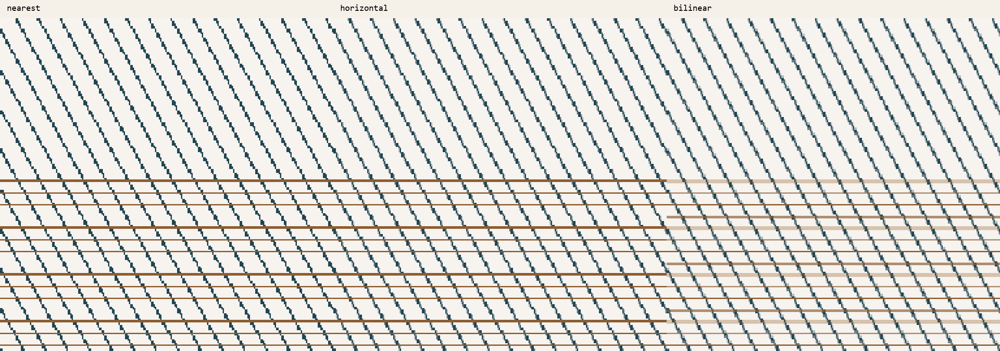
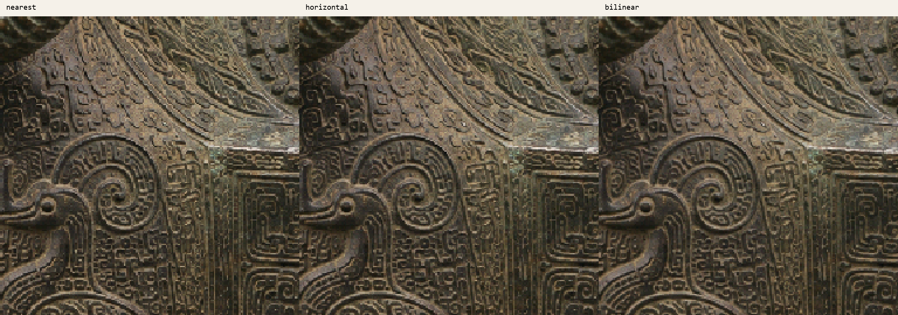

# 独立缩放质量试验（2026-10-02）

## 结论与范围

本轮只评估，不接入正式产品。没有改动主板/副板入口、生产 RTL、已验收 bit、TF 卡素材、图片顺序和音画字幕时间轴。

水平插值和双线性插值均通过独立功能仿真、50 MHz 综合/布局布线/STA。双线性在二维测试纹理上的插值误差明显更低，但会柔化锐利纹饰；水平插值成本较小，不过不能消除纵向采样和 HDMI 第二次最近邻采样的阶梯感。

**建议：本轮不直接合入双线性。若要推进集成候选，先做加载端水平插值，并以完整资源/时序及上板回归决定是否保留。** 当前已验收主板仅剩 314 个 Slice，不能根据小核时序闭合就认定完整工程也能闭合。

对应赛题：选题指南“拓展要求③：不同分辨率图片自适应，鼓励优化缩放质量”；《赛题解析一》第 19 页给出双线性插值示例，第 21 页强调工程实现及逻辑优化。双线性是示例而非指定唯一算法，本试验不宣称新增得分点或分数。

参考原文件：

- [选题指南](<../../../资料/全国大学生嵌入式芯片与系统设计竞赛'2026FPGA赛道选题指南-安路科技 (1).pdf>)
- [赛题解析一](../../../资料/赛题解析一.pptx)

## 真实数据路径与比较方法

当前配置：源 BMP 上限 1920×1080，RGB565 缓存 960×540，HDMI 输出 1280×720。

1. `fat32_image_loader.v` 先把源像素量化为 RGB565，按比例居中适配，以整数商/余数 DDA 选择源像素。
2. `linebuf_scaler_960x540_to_1280x720.v` 在 1× 时按 `floor(3*x/4)`、`floor(3*y/4)` 读取缓存，仍是最近邻。
3. 试验只替换第 1 步的采样公式，保留第 2 步。比较图因此包含现有两级采样代价，而不是直接用电脑高质量缩放冒充 FPGA 输出。

`compare.py` 采用底向上 BMP 的坐标方向，在活动图像区域内反射行号，保持奇数留边的居中方式。软件是坐标/算术模型，不是 FAT32、SD、SDRAM 或加载器逐周期等价仿真。照片输入为素材目录现有 PNG；用于模拟 BMP 解码后的像素，不会写回素材。

三种采样：

- 当前式采样：选中左/下侧的 DDA 整数坐标像素，不混合邻居。
- 水平插值：同一源行左右两像素，Q0.8 水平权重，最后一次四舍五入。
- 双线性：相邻两行四像素，水平中间结果保留 8 位小数，纵向混合后才四舍五入；边界钳位，不读取图像外像素。

试验覆盖一张斜线/细线图、一张可解析的二维正弦纹理，以及五件文物各一张现有细节图。五件实际输入为 1672×940 或 1672×941，适配为 960×539 或 959×540；没有在电脑端先悄悄调整源分辨率。

照片来源路径和 SHA-256 见 [quality_results.json](results/quality_results.json)。其他尺寸、顶部向下 BMP、2×/平移/转场仍须在未来集成候选中回归，不能算作本轮已经验证。

## 质量观察和定量结果

受控二维纹理由连续正弦函数生成，输入采样量化为 RGB565；参考值是在相同 DDA 坐标处直接求连续函数。误差单位是 RGB565 通道编码值的平方，三通道平均。

| 方法 | 受控纹理 MSE | 相对当前式采样降低 |
|---|---:|---:|
| 当前式采样 | 11.443235 | — |
| 水平插值 | 6.012527 | 约 47.46% |
| 双线性 | 0.208717 | 约 98.18% |

这个结果证明该二维测试纹理上的采样精度改善，**不是五件文物的通用画质百分比，也不是细节恢复率**。照片没有高分辨率真实物体的标准答案，因此没有编造照片 PSNR 或主观评分。

目视比较：

- 双线性让斜线边缘灰度过渡更均匀，水平插值仅缓解一个方向。
- 四羊方尊纹饰仍保留，但双线性比当前式采样更柔和；不能只凭变平滑就称“更高清”。
- 第二级 960→1280 最近邻仍存在，三种方案均有重复像素阶梯。
- 大比例缩小时双线性不是面积抗混叠滤波；低分辨率放大也不能创造原图没有的细节。不要把本试验作为这些能力的证明。





全图、其他文物及测试纹理比较在本机 `_build_scale_quality/visuals/`，可用脚本重新生成。放大截图统一用最近邻放大三倍，仅便于检查，不是新增算法。

## 插值核实测资源与时序

工具：ModelSim 10.6e、TD 6.2.168116；器件 EG4S20BG256；独立顶层 50 MHz，输入/输出各 2 ns 外部延迟假设，复位路径豁免。已核实生产加载器在 `museum_media_core.v` 中接 `clk_50m`，不是 SDRAM 或 HDMI 时钟。SD/HDMI/网络不参与这个独立工程。

| 项目 | 水平核 | 双线性核 |
|---|---:|---:|
| 最终 LUT（含 ripple） | 112 | 264 |
| 内部寄存器（TD `#reg`） | 52 | 134 |
| 额外映射到 I/O 的输出寄存器 | 17 | 17 |
| 总顺序单元（含上述 I/O） | 69 | 151 |
| 最终 Slice | 58 | 136 |
| DSP | 1 | 1 |
| BRAM9K / BRAM32K | 0 / 0 | 0 / 0 |
| setup WNS | +4.531 ns | +5.528 ns |
| hold WNS | +0.241 ns | +0.387 ns |
| setup / hold TNS | 0 / 0 | 0 / 0 |
| STA 覆盖率 | 100% | 100% |
| 从接受请求至 done | 9 周期 | 27 周期 |
| 最短相邻请求接受间隔 | 10 周期 | 28 周期 |

核将一个有符号乘法器在各通道/各轴之间时分复用，不是像素时钟下每周期输出一像素的 HDMI 插值器。输入必须在 `!busy` 时提交，`done` 为单周期脉冲，只有 done 后结果完整有效；忙时 start 被忽略。复位取消未完成请求。

独立顶层使用了输出 I/O 寄存器，集成进主板后封装/布局不同，**上述 LUT、寄存器、Slice 不等于最终工程资源增量**。不能将两张报表相加后当作已经闭合的整机结果。原始报告：

- [水平 area](results/horizontal_area.rpt)、[QoR](results/horizontal_qor.rpt)、[STA](results/horizontal_timing.rpt)
- [双线性 area](results/bilinear_area.rpt)、[QoR](results/bilinear_qor.rpt)、[STA](results/bilinear_timing.rpt)

## 未包含的成本与预载影响

已验收主板基线：LUT 17081/19600，Slice 9486/9800（96.80%），BRAM9K 43/64，BRAM32K 10/16，DSP 13/29；setup +0.187 ns，hold +0.023 ns。对应生产 bit SHA-256：`7EE6C57AE2DD2231AB5B76E7F7AC73C9032CADF72063F07378003877646005C9`。

核外尚未实现/测量：

- 两次邻像素读取、邻像素寄存器、权重生成及加载器握手。当前 DDA 只有整数余数，Q0.8 权重不能无成本产生；未来应复用顺序运算，不加入像素路径组合除法。
- 水平插值可以复用现有单行 RAM，但要增加读取阶段；不能继续用当前“一拍写出”的状态直接丢入本核。
- 双线性必须同时保留相邻两源行，正确跨行/跨扇区推进。额外 1920×16 = 30720 bit；按现有 2048 深度原语是 32768 bit。理论可用一块 BRAM32K，实际原语映射、复位和行缓存控制未做综合确认，不能写成“实测只增一块”。
- 中途 KEY4、应急打断、后台预载仲裁和 SDRAM 已接收写事务收尾，都必须做未来集成测试。不要重写已稳定的 FAT/SD 读取通路。

若全部 960×540 输出像素都经过本核，不含邻像素读取/权重生成/SD/SDRAM等待的纯算术连续吞吐预算为：水平约 0.10368 秒/帧，双线性约 0.290304 秒/帧（50 MHz）。这是按请求间隔计算的理论下限，不是板测加载时间，也不能保证与 TF 读取完全重叠。举例：若有五张需要完整运算的图，对应约 0.5184 / 1.45152 秒纯算术预算，不代表实际缓存加载顺序；活动图像有留边时运算量更少。

**本轮没有测得预载提速。** 若未来新增插值造成加载等待显著增加、黑屏或仲裁异常，应拒绝候选，而不是牺牲现有稳定性。

## 测试证据

ModelSim 正向测试 141099 组邻域：

- 全部 65536 种 RGB565 常量色，在变化权重下严格保持。
- 一个双向色彩边界覆盖全部 256×256 权重组合。
- 10000 组固定种子随机四像素/权重，与独立凸权重公式逐位一致。
- 27 个计算阶段分别中途复位，再立即复用。
- 忙时输入扰动/start 不替换当前请求；完成延迟为 9/27 周期；done 单脉冲、完整结果在空闲期保持。

Python 检查等比例/方图/竖图适配尺寸、常量保持、凸组合不越界；构造分数边界测试与半步精确分数对照最大相差一个 RGB565 通道编码。后者只是定点误差检查。

负向验证：在有效计算开始后强制水平输出为 `FFFF`，第一组黑色常量在第 9 周期触发 mismatch，仿真进程退出码 1。证明测试不是空跑或仅检查退出码。见 [正向日志](results/simulation.rpt) 与 [故意错误的负向日志](results/negative_check.rpt)。

生产核心、画面参数核心、已验收 bit 和两份用户未提交文件的 SHA-256 均与开始前相同；副板工作区保持干净。生产工程没有引用本目录，未重新生成正式 bit。

## 如何复现

在 `D:\VSCode\CodeFiles\Git_TD\Anlogic` 执行：

```powershell
py -3 .\experiments\scale_quality\compare.py
& D:\Modelsim\win64\vsim.exe -c -do experiments/scale_quality/run.do -l _build_scale_quality/simulation.log

$env:SCALE_MODE = 'horizontal'
& D:\TD_6.2.1\bin\td_commands_prompt.exe experiments/scale_quality/build.tcl
$env:SCALE_MODE = 'bilinear'
& D:\TD_6.2.1\bin\td_commands_prompt.exe experiments/scale_quality/build.tcl
Remove-Item Env:SCALE_MODE
```

Python 使用现有 Pillow，不需新增 NumPy。原素材默认来自相邻 `素材` 目录，也可用 `--source` 指定现有素材目录；缺少照片时仍生成两张受控测试图。所有重建产物进入已忽略的 `_build_scale_quality/`，不创建新的正式工程入口，不生成板测 bit，不触碰 TF 卡。

下一轮若获准集成：仅水平插值一个候选；先加载器黄金输出/边界/中断仿真，再完整综合/布局布线，setup/hold 均无违例才生成候选 bit。上板需重新验证五栏/名称、自动讲解、暂停/1×/2×/平移、KEY4、手动→自动字幕、应急和网线重连。候选不通过时保留现有已验收版本。
